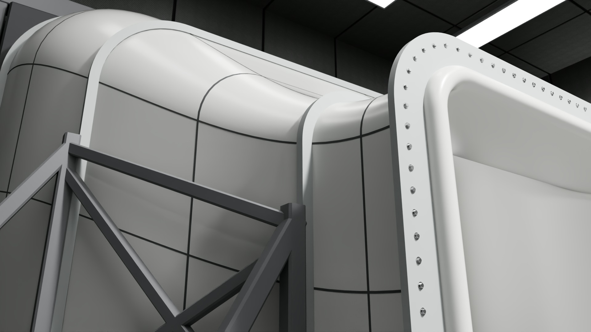
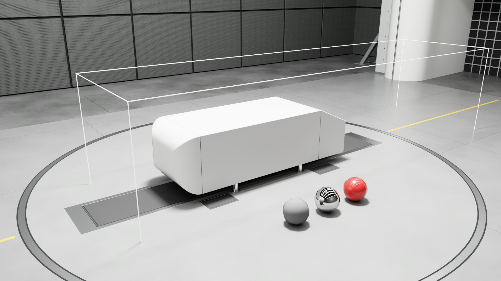
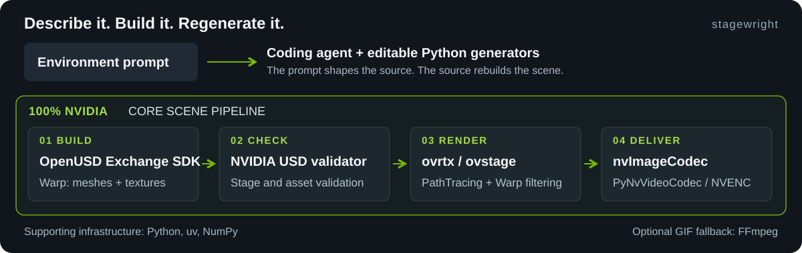

# stagewright

**Prompt-based procedural environments. OpenUSD. A 100% NVIDIA core scene pipeline.**

Describe an environment to a coding agent, which creates or edits the Python generators.
Run the CLI tools to build, validate and render the scene with NVIDIA's tools.
The prompt shapes the code; the code regenerates the world.

**Seamless 360 tour**

https://github.com/user-attachments/assets/bacc0ef1-b90b-4d65-8be2-4a333056c435

## Additional views

| | |
|---|---|
|  |  |
| Blueprint camera pose and lens, with the CFD flow domain outlined | Nozzle flange, seams and A-frame supports |
|  |  |
| Beside the model, looking downstream at the collector | Lighting QC: 18% grey, chrome and clear-coated paint spheres |

[Quickstart](#quickstart) · [Technical guide](models/wind_tunnel/docs/guide.md) · [Live USD guide](docs/live-viewer.md)

## From prompt to procedural world

> Create an open-jet automotive wind tunnel with a honeycomb nozzle, a lit plenum hall,
> a turntable and five-belt floor, and a bell-mouth collector.

The first model builds that wind-tunnel environment from source. An Ahmed-style reference body
is added only in the presentation layer.

## 100% NVIDIA across the core scene pipeline



| Stage | NVIDIA tools |
|---|---|
| Author and compute | OpenUSD Exchange SDK + Warp |
| Validate | NVIDIA USD validator |
| Render and filter | ovrtx / ovstage (RTX PathTracing) + Warp filtering |
| Images and video | nvImageCodec + PyNvVideoCodec / NVENC |
| Optional physics | ovphysx CUDA pose recording + USD replay |
| Optional live review | ovstream WebRTC + ovrtx |

Python, uv and NumPy support the workflow; the coding agent supplies the prompt-to-code step.
The optional GIF fallback uses FFmpeg. The NVIDIA claim covers the core scene and media stages above.

## Checked, with clear boundaries

The shipped wind-tunnel presentation was checked for composition, transforms, bounds, camera
framing and rendered loop continuity. Its strict fit report records all 29 checks passing.
See the [fit report](models/wind_tunnel/docs/fit-check.md) and
[verification details](models/wind_tunnel/docs/guide.md#what-was-verified).

This is a conceptual presentation environment. Execution inside the external blueprint application
and aerodynamic behavior are unverified. Fine-pattern shimmer can remain in motion.

## Quickstart

Windows, Python 3.13, [uv](https://github.com/astral-sh/uv) and an NVIDIA RTX GPU with a compatible driver.

```powershell
git clone https://github.com/sushiHex/stagewright.git
cd stagewright
uv venv --python 3.13 .venv
uv pip install --python .venv/Scripts/python.exe -r requirements.txt

.venv/Scripts/python.exe tools/build_env.py
.venv/Scripts/python.exe tools/build_present.py
.venv/Scripts/python.exe tools/check_presentation.py
.venv/Scripts/python.exe tools/render.py --products Hero
```

The hero lands in `build/stills/hero.png`. Keep authoring and rendering in separate processes.
Use the [technical guide](models/wind_tunnel/docs/guide.md#build-it) for motion, validation,
render controls and [blueprint integration](models/wind_tunnel/docs/guide.md#using-the-override).

## Use the environment

The environment payload, `models/wind_tunnel/assets/test_section.usda`, contains the hall,
hardware and lighting. The [override](models/wind_tunnel/scenes/blueprint_override.usda) replaces
the blueprint's environment while keeping the presentation prop separate.

`models/wind_tunnel/` holds the first model. `tools/` holds the builders and shared render helpers.
All shipped geometry and textures are procedural; external blueprint content and dependencies
are not bundled. See [assets and provenance](models/wind_tunnel/docs/assets.md).

[MIT](LICENSE) for original code and generated content. Dependencies retain their own terms.
