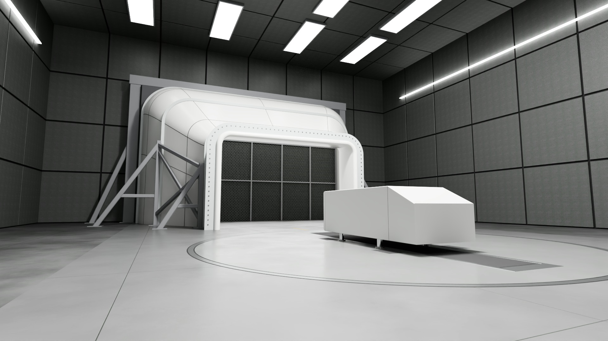
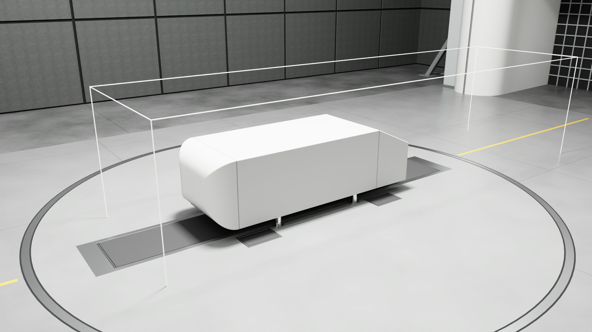
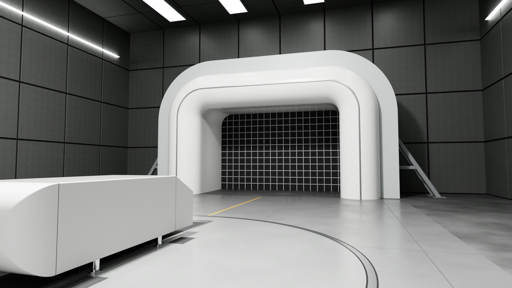
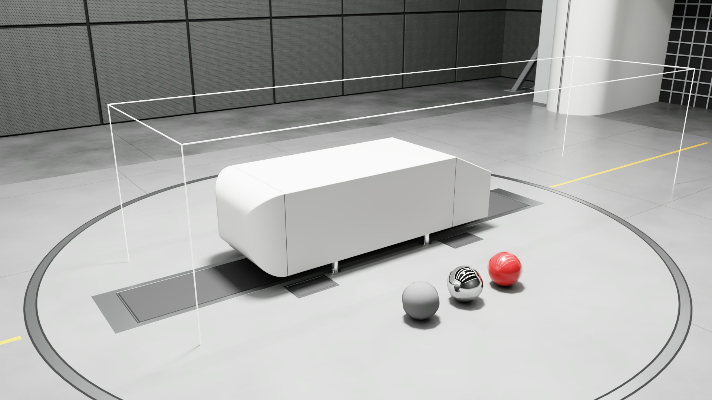

# stagewright

Parametric OpenUSD worlds, built from source. Each model is generated by deterministic code, validated
with NVIDIA's USD validator and rendered headless with RTX path tracing.

## First model: open-jet test section

A conceptual presentation environment: a full-scale open-jet, three-quarter test section for an
automotive wind tunnel, authored in OpenUSD and rendered headless with RTX path tracing. It is built
to drop into the environment slot of NVIDIA's real-time wind tunnel blueprint,
[digital-twins-for-fluid-simulation](https://github.com/NVIDIA-Omniverse-blueprints/digital-twins-for-fluid-simulation),
through a single override layer.



[Watch the dolly move from the wake side toward the nozzle (MP4)](media/dolly.mp4)

The environment is a plenum hall with acoustic wall panels and ceiling light panels. Upstream sits a
contraction nozzle with a honeycomb visible through its exit; downstream, a bell-mouth collector.
Between them is an open jet over a test floor with a turntable, a five-belt rolling road (a centre
belt between the wheels and four wheel-drive belts under the tyres) and a painted centreline. There
are no walls or ceiling around the model itself. The presentation scene adds an Ahmed-style
reference body as a stand-in model, a lighting QC set and cameras; none of that is part of the
environment that goes into the blueprint.

This is a presentation environment, not a validated test facility. It has not been run inside the
blueprint application. See "What was verified" for exactly what was checked.

| | |
|---|---|
|  |  |
| From a copy of the blueprint's `CameraMAIN_00` (same pose and lens), with the blueprint's CFD flow domain drawn as a wire box | Detail: nozzle flange, seams and A-frame supports |
|  |  |
| Beside the model, looking downstream at the collector | Lighting QC: 18% grey, chrome and clear-coated paint spheres |

## What was verified

`tools/fit_check.py` composes the blueprint's own stage with the override and measures it. The full
report, with every source value cited by file and line, is [docs/fit-check.md](docs/fit-check.md).
In summary:

- **Override composition.** The override sublayers the blueprint's `Main.usda` and replaces the
  payload on `/World/WindTunnel` with an explicit list-op. The composed payload list is only this
  environment; the original `windTunnelEnv` layer is not used once the stage is loaded.
  `/World/WindTunnel` stays at identity, and the override introduces no composition errors
  attributable to this environment, and no unresolved asset paths under `/World/WindTunnel`. The
  composed stage does carry the blueprint's own unresolved assets, which this check reports but
  cannot fix: one composition error (the `/World/CarCFD` PLY payload, an LFS object that was not
  fetched) and 20 asset paths owned by `/World/CAE` and `/World/CarHero` (renderer search paths,
  remote content and unfetched textures).
- **Units.** Both the override and the environment are Z-up, centimetres (metersPerUnit 0.01), 60
  time codes per second, matching the blueprint.
- **Domain containment.** The CFD domain, recomputed from the blueprint source, is X -144..144,
  Y -650..430, Z -4..248 cm. No environment geometry enters it apart from floor inserts below
  Z 0.5 cm (the domain floor sits 4 cm below the floor top, which is the blueprint's own
  convention). The domain sits inside the jet: the nozzle mesh's most downstream point (its rolled
  lip) is 332.5 cm upstream of the domain's inlet face, and the collector mesh's most upstream point
  is 450.0 cm downstream of its outlet face. The cross-section clearances, 181.0 cm at the nozzle
  and 256.0 cm at the collector, are the smallest distances from any vertex of that mesh to the
  domain's X-Z rectangle (vertex-based, so the rounded corners are measured at their chords).
- **Hero car fit.** With the blueprint's hero car geometry fetched, the car sits inside the domain
  and on the turntable (farthest point 257.6 cm from the centre of a 500 cm radius), the turntable
  is centred on its mid-wheelbase, the centre belt runs between the wheels for the car's full
  length, and each tyre's contact patch lies on one of the four wheel-drive belts.
- **Camera clearances.** All eight blueprint cameras stay out of solid environment geometry, out of
  the nozzle and collector openings, and inside the hall. These are tested at each camera's
  authored time samples (2361 positions in all); the paths between samples are not swept. The
  smallest exact distance from any sample to the nozzle surface is 99.9 cm (`Camera_ANIM3`). A
  stricter, plane-based figure: of the samples within the nozzle's width and height, the closest
  comes 35.2 cm, measured along Y only, to the plane of the nozzle lip (`Camera_ANIM3`). The nozzle
  exit was moved upstream to Y +775 to keep that figure above 30 cm.
- **Lights.** The environment brings its own 30 lights, and nothing else in the composed stage
  contributes any, as the blueprint expects of its environment.
- **No scanned blueprint source addresses the old environment.** A text search of the blueprint's
  117 `.py`, `.kit`, `.toml`, `.json`, `.js`, `.ts` and `.usda` files for the old environment's prim
  and asset names finds only the `/World/WindTunnel` definition and its payload arc in `Base.usda`,
  which the override replaces. Its scope: binary `.usd`/`.usdc` layers and other file types were not
  searched, LFS pointers and files over 8 MB would have been skipped (none were), and the original
  environment (`windTunnelEnv.usd`, an LFS object) was not fetched, so its contents were not
  inspected. A lookup assembled at run time would not be found by a text search.
- **Renders.** The blueprint's own stage with the override applied loads and renders in ovrtx from
  its `CameraMAIN_00`. That render shows the blueprint's car, so it was kept private and is not
  published. The images here come from this repo's presentation scene, with the Ahmed body in place
  of the blueprint's car. Its copy of `CameraMAIN_00` matches the blueprint camera's pose and lens
  (position, rotation, focal length, apertures) but not its exposure or clipping: the blueprint
  camera sets an exposure responsivity of 1.103 and a far clipping distance of 10,000,000 cm, while
  the copy carries no exposure attributes (so the renderer defaults apply) and clips at 100,000 cm.
- **Dolly path.** `tools/build_present.py` refuses a dolly camera path that comes within 30 cm of
  any environment or prop bounding box; the current path's closest approach is 44.9 cm, to the
  floor at its low start.

**Not verified:**

- Running inside the blueprint application (Kit, the inference service, the streamer). Nothing here
  launches it.
- The inference geometry (`/World/CarCFD`) placement, which needs a PLY plugin that Kit supplies.
- Occlusion in camera views; the "in view" tests are frustum against bounding box only.
- Camera positions between authored time samples.
- Renders from the blueprint cameras other than `CameraMAIN_00`.

## Simplifications

This is a presentation environment, and several physical parts are stand-ins:

- **Materials remain procedural UsdPreviewSurface.** Texture and mesh computation runs in Warp.
  Spectral noise uses Warp's seeded generator, so noise patterns differ from earlier builds while
  keeping their periodic spectrum. SimReady material assets have not been downloaded; dataset terms
  and renderer support must be checked before using them.
- **Flow conditioning is surface-deep.** The honeycomb and the collector's safety screen are
  textured surfaces with solid backing, a render shortcut. They are not flow-through geometry.
- **No ducting beyond the test section.** Nothing upstream of the settling chamber (fan, corners,
  return circuit) or downstream of the collector's diffuser is modelled.
- **Ground simulation is static geometry.** The five-belt layout (a centre belt between the wheels
  plus four wheel-drive belts under the tyres, fixed at the blueprint car's track and wheelbase)
  shows where the belts would be. There is no model restraint or balance system, no
  boundary-layer suction or scoop ahead of the belts, and nothing moves.
- **The Ahmed body is an Ahmed-style presentation prop.** It is scaled 4.3 times, to about
  4.49 x 1.67 x 1.24 m, with stilt positions chosen for the presentation. It is not a
  benchmark-equivalent model.
- **No aerodynamic link to the blueprint.** The environment has no relationship to the blueprint's
  inference. Its inputs are the car configuration and speed (velocity, spoiler, rims and mirrors in
  the blueprint's `workflow.toml`), so the nozzle, collector and floor here do not affect the flow
  it shows, and the flow it shows is not that of this test section.

## Using the override

Clone the blueprint into `external/blueprint` without its large LFS content, then check out the
commit this repository was checked against.

PowerShell:

```
$env:GIT_LFS_SKIP_SMUDGE=1; git clone https://github.com/NVIDIA-Omniverse-blueprints/digital-twins-for-fluid-simulation.git external/blueprint
git -C external/blueprint checkout 62610544f41a338a8abbbe32e2e902d4107c506d
```

bash:

```
GIT_LFS_SKIP_SMUDGE=1 git clone https://github.com/NVIDIA-Omniverse-blueprints/digital-twins-for-fluid-simulation.git external/blueprint
GIT_LFS_SKIP_SMUDGE=1 git -C external/blueprint checkout 62610544f41a338a8abbbe32e2e902d4107c506d
```

In PowerShell the variable stays set for the rest of the session, so the checkout skips LFS
content too.

The hero car is not needed for the override itself. For the car checks in the fit report, fetch
only that object. This needs [Git LFS](https://git-lfs.com) installed and set up once with
`git lfs install`:

```
git -C external/blueprint lfs pull --include="source/specializations/auto-aero/stages/layers/CarHero/**"
```

The override is [scenes/blueprint_override.usda](scenes/blueprint_override.usda). Its whole content,
apart from metadata, is:

```usda
#usda 1.0
(
    defaultPrim = "World"
    metersPerUnit = 0.01
    subLayers = [
        @../external/blueprint/source/specializations/auto-aero/stages/Main.usda@
    ]
    timeCodesPerSecond = 60
    upAxis = "Z"
)

over "World"
{
    over "WindTunnel" (
        payload = [@../assets/test_section.usda@</Environment>]
    )
    {
    }
}
```

The payload is an explicit list-op on purpose: `prepend` would add this environment in front of the
blueprint's and keep the original one loading alongside it. The payload targets `/Environment`, the root of `assets/test_section.usda`, which has an identity
transform and carries the environment's lights.

Expected layout:

```
stagewright/
  assets/test_section.usda
  scenes/blueprint_override.usda
  external/blueprint/            (clone, not tracked)
```

### Using it in the blueprint application

This was not exercised here. The override only takes effect if the application opens it, and the
application names its stage in two places in the blueprint source:

- the workflow manifest,
  `external/blueprint/source/specializations/auto-aero/workflow/workflow.toml`, line 20:
  `default_stage = "${app}/../rtwt/stages/Main.usda"` under `[workflow]`;
- the Kit app settings, `exts."omni.cae.startup".usdFile = "${app}/../rtwt/stages/Main.usda"`, in
  `apps/omni.rtwt.webrtc.kit` (line 53) and `apps/omni.rtwt.editor.kit` (line 92) under the same
  `auto-aero` directory.

Using the environment in the application therefore means either pointing those at the override
root (whose relative paths assume it stays at `scenes/` in this repository, next to
`external/blueprint`), or copying the override's explicit payload opinion on `/World/WindTunnel`
into a root layer the application already opens. Neither was tried.

## Toolchain

| Step | Tool |
|---|---|
| Authoring geometry, materials, lights, cameras | [OpenUSD Exchange SDK](https://github.com/NVIDIA-Omniverse/usd-exchange) (`usd-exchange` 3.0.1, `usdex.core`) and the OpenUSD it bundles |
| Validation | NVIDIA USD validator (`usd-validation-nvidia` 1.22.0, `nvidia_usd_validate`) |
| Rendering | `ovrtx` 0.6.0 and `ovstage` 0.3.0, headless RTX path tracing |
| Procedural textures and mesh computation | NVIDIA Warp (`warp-lang` 1.18.0): spectral noise, material maps, profiles, lofts, sweeps, normals and UVs |
| PNG and JPEG | NVIDIA nvImageCodec (`nvidia-nvimgcodec-cu12` 0.9.0.20) |
| MP4 | NVIDIA PyNvVideoCodec 2.2.3 (NVENC encode and MP4 mux) |
| Optional GIF fallback (`--gif`) | ffmpeg, with a generated palette |

Every stage is NVIDIA: authoring, procedural computation, validation, rendering, image writes and
MP4 encoding use the tools above. Python orchestrates the build; numpy carries arrays between Warp,
OpenUSD and the renderer, packs indexed USD data, and supports diagnostic checks. PyNvVideoCodec's
muxer uses libav internally. Only the optional GIF fallback requires the ffmpeg executable.

Geometry is parametric Python: every dimension sits in one config block at the top of
`tools/build_env.py`, so the environment can be regenerated deterministically. Do not install
`usd-core` into the same environment; `usd-exchange` ships its own OpenUSD and conflicts with it.

The environment asset passes every validator rule except the one asking for large arrays to be
stored as binary crate files, which cannot pass while the assets stay human-readable USDA. The
presentation scenes fail the same rule (for large arrays and for the dolly camera's time samples)
and carry one warning, because their `/Render` scope sits beside the default prim `/World`.

### Build it

Windows, Python 3.13, with [uv](https://github.com/astral-sh/uv) and an NVIDIA GPU:

```
uv venv --python 3.13 .venv
uv pip install --python .venv/Scripts/python.exe "ovrtx==0.6.0.1791947691" "ovstage==0.3.0.1791986420" "usd-exchange==3.0.1" "usd-validation-nvidia==1.22.0" "numpy==2.5.4"
uv pip install --python .venv/Scripts/python.exe "pynvvideocodec==2.2.3" "nvidia-nvimgcodec-cu12[all]==0.9.0.20" "warp-lang==1.18.0"

.venv/Scripts/python.exe tools/build_env.py            # assets/test_section.usda and assets/textures/
.venv/Scripts/nvidia_usd_validate.exe assets/test_section.usda
.venv/Scripts/python.exe tools/build_present.py        # scenes/present.usda, scenes/present_payload.usda
.venv/Scripts/python.exe tools/fit_check.py --strict   # docs/fit-check.md (needs external/blueprint)
.venv/Scripts/python.exe tools/render.py --res 1920x1080 --spp 256 --prefix final_
.venv/Scripts/python.exe tools/render.py --products Main --qc --res 1920x1080 --spp 256 --prefix final_qc_
.venv/Scripts/python.exe tools/render_motion.py --res 1280x720 --spp 64 --encode
.venv/Scripts/python.exe tools/build_media.py          # approved presentation outputs to media/
```

Authoring (`pxr`) and rendering (`ovrtx`) always run in separate processes, because ovrtx carries
its own USD runtime. Stills land in `build/stills/`, frames in `build/frames/dolly/`, and the MP4
in `build/out/`. To encode an existing complete sequence, use `tools/render_motion.py --no-render --encode`. Add `--gif` only to request the optional GIF; that flag requires ffmpeg on the path.
`tools/build_media.py` copies only fixed presentation output paths, never `build/private/`.

Run `.venv/Scripts/python.exe tools/check_compute.py` for numerical and codec regression checks.
It checks the spectral noise against an independent Fourier reference, mesh geometry, lossless PNG,
JPEG, and MP4 color and frame order. Its fixtures stay under `build/checks/`.

`tools/fit_check.py` exits non-zero if any check fails. With `--strict` it also fails when a check
could not run, such as the car checks when the CarHero LFS content has not been fetched.
`tools/render.py` exits non-zero if any requested camera produced no frame.

## Repository layout

```
assets/test_section.usda     the environment payload (root prim /Environment)
assets/textures/             procedural textures, generated by tools/build_env.py
scenes/blueprint_override.usda   the drop-in override for the blueprint stage
scenes/present.usda          presentation root: environment by reference, plus the Ahmed body,
                             QC spheres, cameras (including the animated Dolly) and RenderProducts
scenes/present_payload.usda  the same, with the environment loaded as a payload
tools/build_env.py           builds the environment and its textures
tools/build_present.py       builds the presentation roots and checks the dolly path clearance
tools/meshlib.py             mesh assembly (lofts, sweeps, rounded sections)
tools/mesh_compute.py        Warp mesh kernels
tools/texture_compute.py     Warp spectral noise and material-map kernels
tools/image_io.py            nvImageCodec PNG/JPEG IO
tools/video_io.py            PyNvVideoCodec NVENC encode and MP4 mux
tools/video_pixels.py        Warp RGB-to-NV12 conversion
tools/build_media.py         fixed presentation output paths to media/
tools/check_compute.py       numerical and codec regression checks
tools/fit_check.py           the fit check, writes docs/fit-check.md
tools/render.py              stills
tools/render_motion.py       the dolly sequence, MP4 and optional GIF
tools/smoke.py               renderer smoke test
tools/rtx.py                 shared ovrtx session, stepping and readback helpers for the three above
docs/                        plan, fit-check report, asset and reference notes
media/                       images used by this README
```

## The Ahmed body

The model on the turntable is an Ahmed-style presentation prop, modelled on the Ahmed body, the
standard bluff-body reference shape from
S. R. Ahmed, G. Ramm and G. Faltin, "Some Salient Features of the Time-Averaged Ground Vehicle
Wake", SAE Technical Paper 840300 (1984). It is built from published dimensions (1044 x 389 x 288 mm,
25 degree rear slant) as restated by the ERCOFTAC knowledge base and COMSOL's model of the same body,
not from a downloaded model. The stilt positions are chosen for the presentation, and one dimension
(whether the 222 mm slant length runs along the slant or along the axis) is not settled by those
sources. It is shown at 4.3 times model scale (about 4.49 x 1.67 x 1.24 m) so it reads at car size,
which makes it a prop rather than a benchmark-equivalent model. See
[docs/assets.md](docs/assets.md) for the details. It is a presentation prop only and is not part of
the environment payload.

## Licences

- **This repository's code and generated content:** Licence: TBD.
- **Textures:** all procedural, computed in Warp by `tools/build_env.py` and written through nvImageCodec. No
  third-party textures, HDRIs or models are used.
- **The blueprint** (`digital-twins-for-fluid-simulation`) is under the NVIDIA Omniverse License
  Agreement, and **ovrtx** and **ovstage** are under the NVIDIA Software License Agreement. None of
  them is redistributed here: the blueprint is cloned locally into the untracked `external/`, and the
  renderer packages are installed from their package index.
