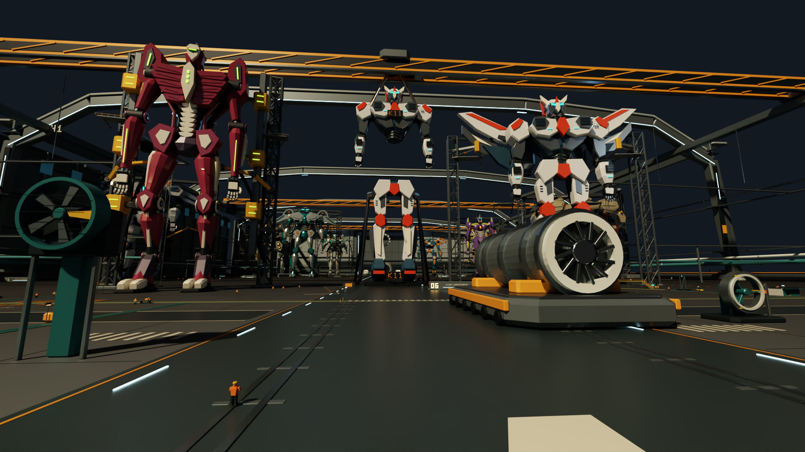
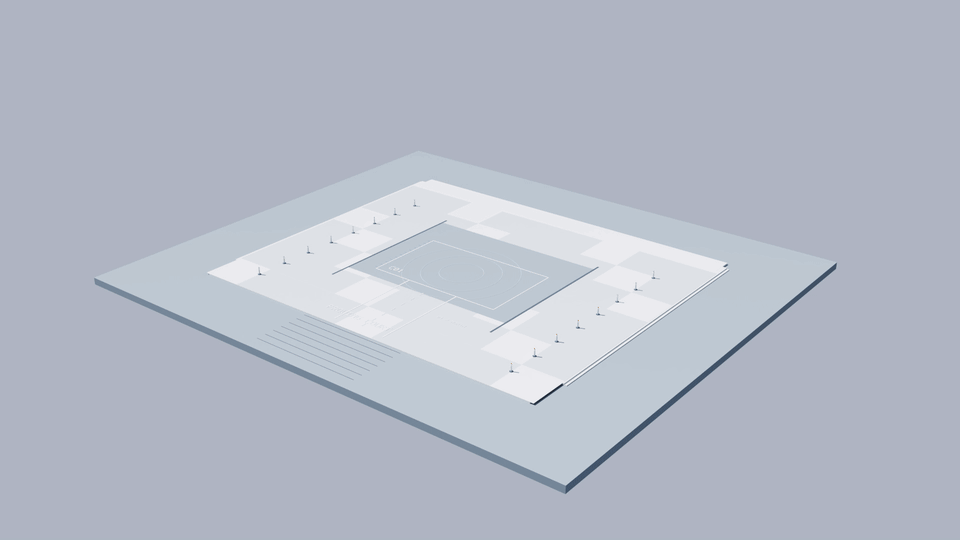
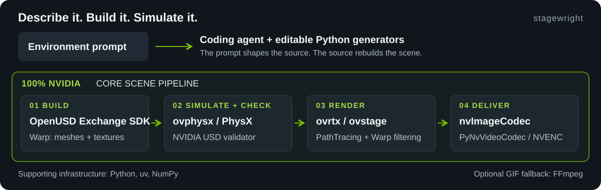
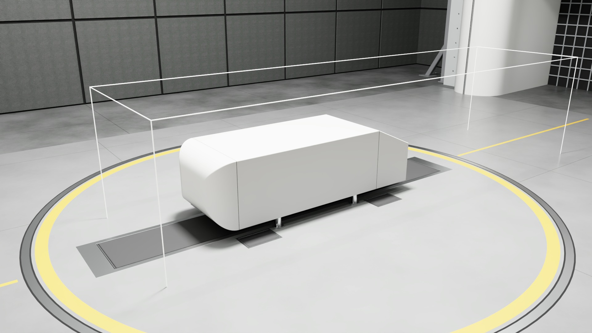
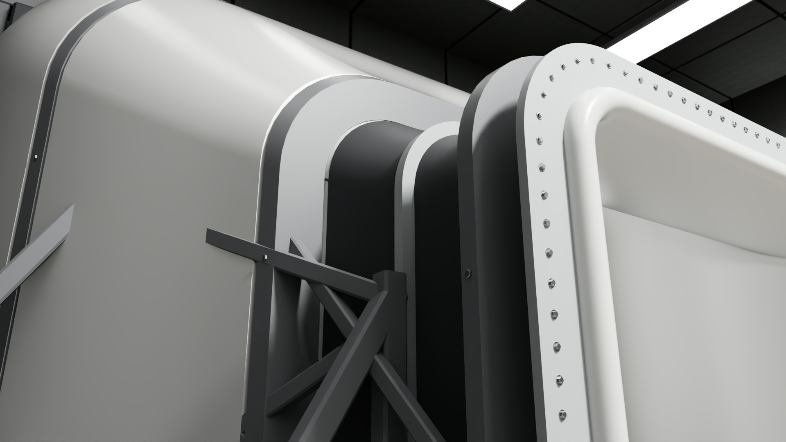
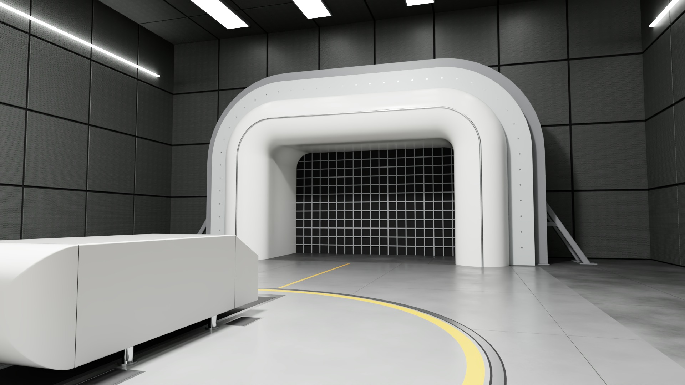
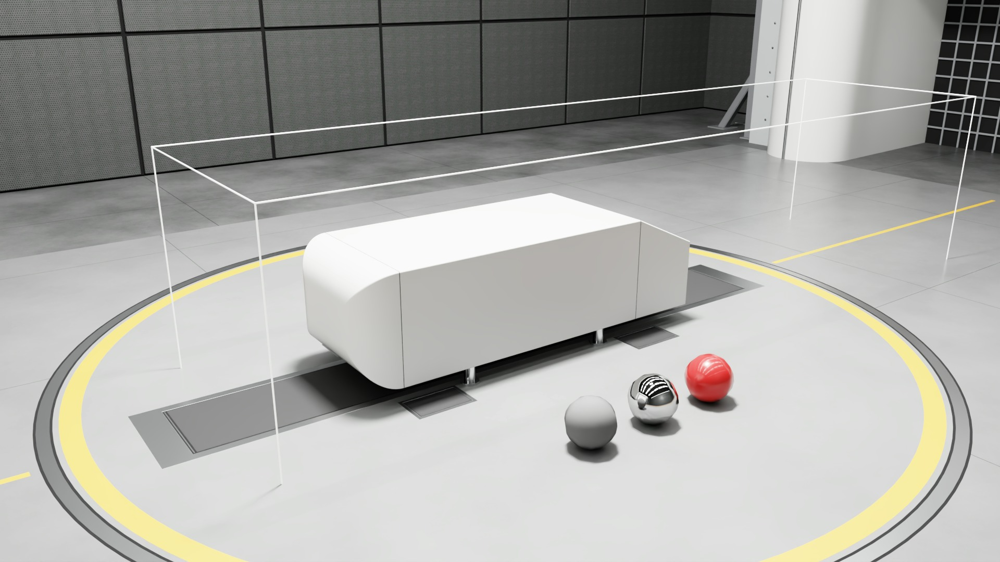

# stagewright

**Prompt-based procedural environments. OpenUSD (Open Universal Scene Description). A 100% NVIDIA core scene pipeline.**

Describe an environment. A coding agent writes editable Python generators.
NVIDIA libraries build the OpenUSD scene, simulate its mechanisms and render the result.
The prompt shapes the code; the code regenerates the world.

Companion project: [**acceptance-lab**](https://github.com/sushiHex/acceptance-lab) grades an agent's changes to OpenUSD scenes against a written contract, and trains on the result.

## Current study: mecha assembly



A traveling bridge carries a mecha upper body toward its matching legs. A driven joint
moves the bridge; a passive hinge lets the load swing under gravity. PhysX records the
body poses, and RTX renders their USD replay.

Work in progress: a shorter assembly sequence, final lowering and capture that keeps
the desktop responsive. Follow [the factory study](https://github.com/sushiHex/stagewright/issues/51).

## Build from source

| Model | What it does |
|---|---|
| [COURTYARD](models/courtyard/README.md) | One motor lifts the roof and wall to open a proving court. |
| [Inspection hall](models/inspection_hall/README.md) | One motor opens the roof and deploys a deck through passive joints. |
| [Wind tunnel](models/wind_tunnel/docs/guide.md) | Procedural hall, nozzle, test section and collector, with a Blueprint override. |

**COURTYARD: saved construction stages and recorded PhysX motion**



Construction studies retain the prompt, declared inputs and model settings with their
results. Saved USD revisions show scene changes; recorded solver poses show motion.
The [live USD observer](docs/live-viewer.md) displays published revisions through RTX and WebRTC (Web Real-Time Communication).

## 100% NVIDIA across the core scene pipeline



| Stage | NVIDIA tools |
|---|---|
| Author and compute | OpenUSD Exchange SDK + Warp |
| Simulate and replay | ovphysx / PhysX CUDA pose recording + USD replay |
| Validate | NVIDIA USD validator |
| Render and filter | ovrtx / ovstage (RTX PathTracing) + Warp filtering |
| Images and video | nvImageCodec + PyNvVideoCodec / NVENC (NVIDIA Encoder) |
| Optional live review | ovstream WebRTC + ovrtx |

The claim covers these core stages. Python, uv, NumPy and the coding agent support
the workflow; optional GIF export uses FFmpeg. NVIDIA libraries retain their own licenses.

## Quickstart

Windows, Python 3.13, [uv](https://github.com/astral-sh/uv) and an NVIDIA RTX GPU with a compatible driver.

```powershell
git clone https://github.com/sushiHex/stagewright.git
cd stagewright
uv venv --python 3.13 .venv
uv pip install --python .venv/Scripts/python.exe -r requirements.txt

.venv/Scripts/python.exe models/courtyard/build.py --out build/courtyard
```

Open `build/courtyard/scene.usda` to inspect the scene. Follow the
[COURTYARD guide](models/courtyard/README.md#record-the-mechanism) to install the separate
physics environment, record powered and motor-off runs, and render their replay.
Keep authoring, physics and rendering in separate processes. Check and reserve GPU
capacity through vram-mcp before GPU work; use one worker at a time.

These are conceptual environments. Recorded rigid-body motion does not establish
structural strength or aerodynamic validity. Each model guide states what was checked.
External Blueprint content and dependencies are not bundled.

<details>
<summary>Wind tunnel: seamless 360 tour and additional views</summary>

https://github.com/user-attachments/assets/bacc0ef1-b90b-4d65-8be2-4a333056c435

| | |
|---|---|
|  |  |
| Blueprint camera pose and lens, with the CFD (computational fluid dynamics) flow domain outlined | Nozzle flange, seams and A-frame supports |
|  |  |
| Beside the model, looking downstream at the collector | Lighting QC (quality control): 18% grey, chrome and clear-coated paint spheres |

See the [technical guide](models/wind_tunnel/docs/guide.md),
[fit report](models/wind_tunnel/docs/fit-check.md) and
[asset provenance](models/wind_tunnel/docs/assets.md).

</details>

**SIMPLIFICATION IS PROGRESS.**

[MIT](LICENSE) for original code and generated content. Dependencies retain their own terms.
